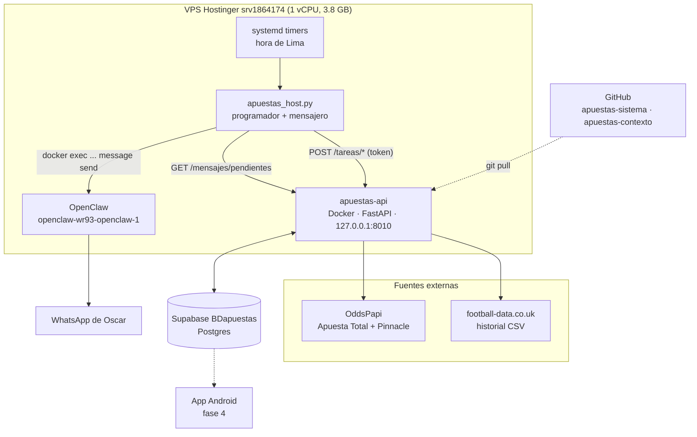
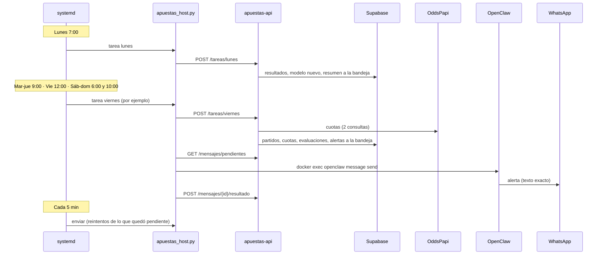
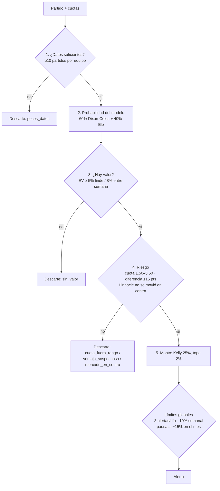

# Arquitectura

## Vista general

## Componentes

| Componente | Responsabilidad | Dónde |
|---|---|---|
| `apuestas-api` | Todo el cálculo: descarga, modelo, embudo, mensajes (los deja en la bandeja) | Docker en el VPS, solo en `127.0.0.1:8010`, UID 10001, 768 MB / 0.5 CPU |
| Programador | A cada hora fija pide una tarea a la API | Timers de systemd en el VPS |
| Mensajero | Entrega la bandeja por WhatsApp con `docker exec` a OpenClaw; reintenta | `vps/apuestas_host.py` en el VPS (root) |
| Supabase | Partidos, cuotas, modelos, evaluaciones, bandeja de mensajes, apuestas reales, uso de API | Proyecto `BDapuestas` (us-west-2) |
| OpenClaw | Sesión de WhatsApp; entrega el texto tal cual | Contenedor existente del VPS |
| GitHub | Código versionado (`apuestas-sistema`) y contexto (`apuestas-contexto`) | Nube |
| n8n (opcional) | Podría reemplazar a los timers; no está instalado | — |

El orquestador no calcula: si mañana se cambian los timers por n8n u otra cosa, el sistema sigue igual.
Ver [ADR 0004](../02-decisiones/0004-n8n-solo-orquesta.md) y [ADR 0010](../02-decisiones/0010-programador-systemd-y-mensajero.md).

Puntos de conexión y cómo probarlos: [06-guias/conexiones.md](../06-guias/conexiones.md).

## Flujo semanal

## Embudo de decisión (dentro de `apuestas-api`)

Detalle de cada paso: [04-modelo/modelo-y-embudo.md](../04-modelo/modelo-y-embudo.md).

## Seguridad

- La API no se publica a internet: escucha en `127.0.0.1` (el VPS tiene UFW desactivado, así que nada en `0.0.0.0`).
- El mensajero es el único que toca WhatsApp, y solo ejecuta un comando fijo sin shell.
- La API corre con UID 10001, distinto del 1000 que comparten OpenClaw y memory-api.
- Todas las rutas (menos `/salud`) piden la cabecera `X-API-Token`.
- RLS activado en todas las tablas de Supabase. El backend entra con el usuario `postgres`;
  la futura app usará políticas de solo lectura.
- Secretos únicamente en `.env` del VPS. `.gitignore` lo excluye.
