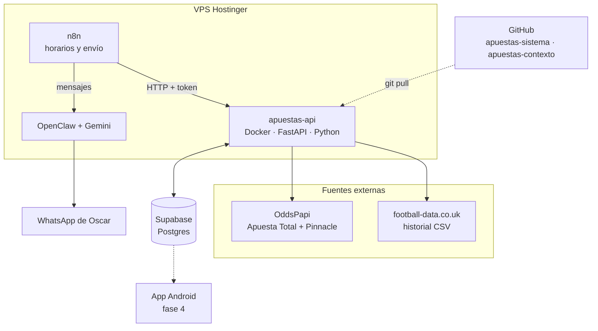
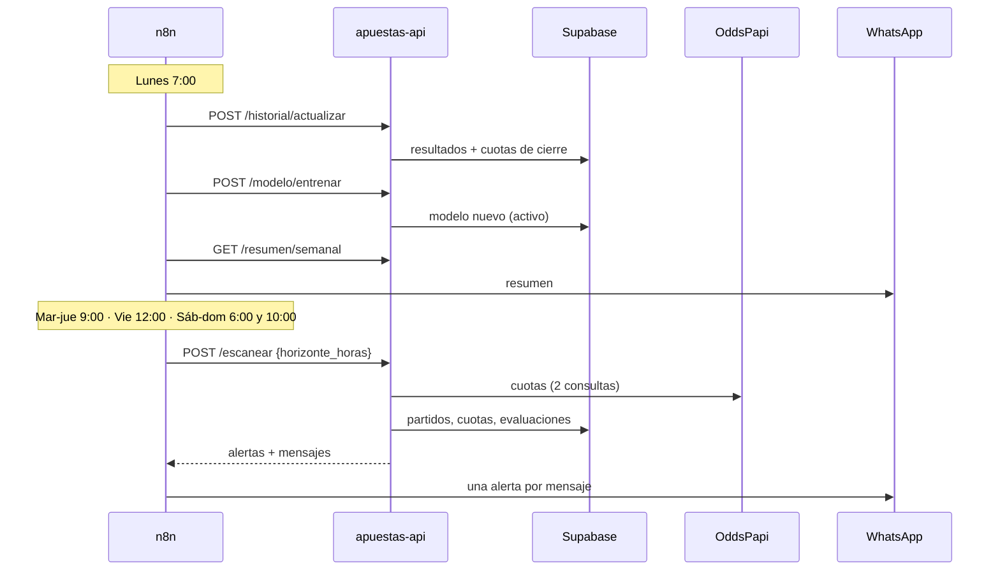
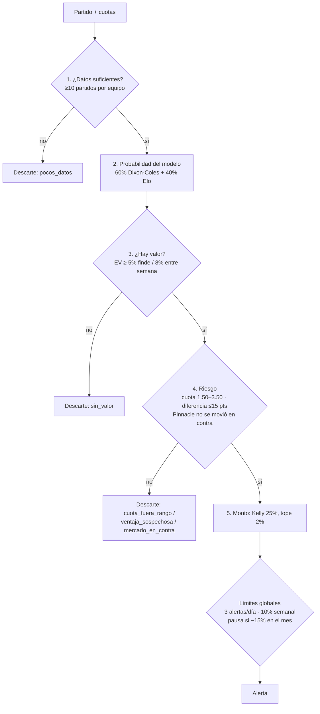

# Arquitectura

## Vista general

## Componentes

| Componente | Responsabilidad | Dónde |
|---|---|---|
| `apuestas-api` | Todo el cálculo: descarga, modelo, embudo, mensajes | Docker en el VPS, solo en `127.0.0.1:8010` |
| n8n | Horarios (cron), llamar a la API, reenviar mensajes, avisar errores | VPS |
| Supabase | Partidos, cuotas, modelos, evaluaciones, apuestas reales, uso de API | Nube (proyecto propio o esquema `apuestas` en uno existente) |
| OpenClaw + Gemini | Entregar el mensaje por WhatsApp | VPS |
| GitHub | Código versionado (`apuestas-sistema`) y contexto (`apuestas-contexto`) | Nube |

n8n no calcula nada: si mañana se cambia n8n por otra cosa, el sistema sigue igual.
Ver [ADR 0004](../02-decisiones/0004-n8n-solo-orquesta.md).

Todos los mensajes salen por un único flujo de n8n (**98 - Enviar mensaje**), que entrega a
WhatsApp por comando de OpenClaw, por su webhook o por otro webhook.
Ver [ADR 0009](../02-decisiones/0009-envio-centralizado.md).

Puntos de conexión y cómo probarlos: [06-guias/conexiones.md](../06-guias/conexiones.md).

## Flujo semanal

## Embudo de decisión (dentro de `apuestas-api`)

Detalle de cada paso: [04-modelo/modelo-y-embudo.md](../04-modelo/modelo-y-embudo.md).

## Seguridad

- La API no se publica a internet: escucha en `127.0.0.1`. Solo n8n (en el mismo VPS) la llama.
- Todas las rutas (menos `/salud`) piden la cabecera `X-API-Token`.
- RLS activado en todas las tablas de Supabase. El backend entra con el usuario `postgres`;
  la futura app usará políticas de solo lectura.
- Secretos únicamente en `.env` del VPS. `.gitignore` lo excluye.
