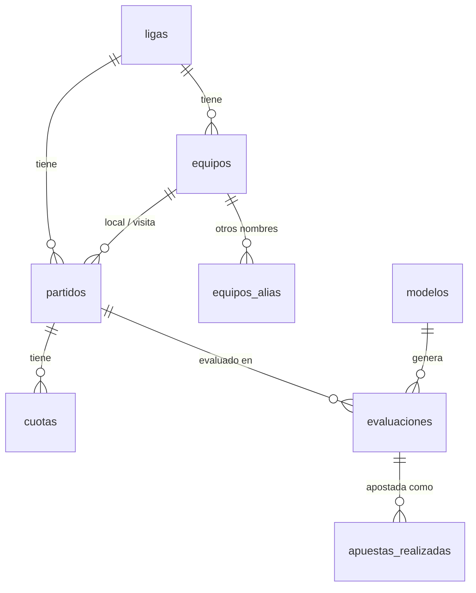

# Modelo de datos (Supabase)

Script: `apuestas-sistema/supabase/migrations/0001_esquema_inicial.sql`



## Tablas

| Tabla | Qué guarda | Quién escribe |
|---|---|---|
| `ligas` | Ligas configuradas (código, ID en OddsPapi, activa) | Sistema (desde `ligas.yaml`) |
| `equipos` | Nombre "oficial" de cada equipo = el de football-data | Sistema |
| `equipos_alias` | Cómo llama OddsPapi a cada equipo | Sistema (auto si similitud ≥ 0.80) o tú |
| `alias_pendientes` | Nombres que no se pudieron emparejar solos | Sistema → **revisar a mano** |
| `partidos` | Partidos pasados (con resultado) y próximos | Sistema |
| `cuotas` | 3 cuotas (local/empate/visita) de una casa en un momento | Sistema |
| `modelos` | Parámetros de cada modelo entrenado (JSON) | Sistema (lunes) |
| `evaluaciones` | Cada vez que el embudo evalúa un partido: pick o descarte + motivo | Sistema |
| `apuestas_realizadas` | Lo que apostaste de verdad | Tú (comando o endpoint) |
| `ejecuciones` | Registro de cada corrida (ok / error) | Sistema |
| `uso_api` | Cada consulta a OddsPapi (para no pasar el límite) | Sistema |

### `cuotas.casa` y `cuotas.tipo`

| casa | tipo | Origen |
|---|---|---|
| `apuestatotal` | `apertura` (primera vez vista), `snapshot` (siguientes) | OddsPapi |
| `pinnacle` | `apertura`, `snapshot` | OddsPapi |
| `pinnacle` | `previa`, `cierre` | football-data |
| `b365` | `previa` | football-data |
| `promedio` | `cierre` | football-data |

### `evaluaciones.motivo`

`pocos_datos`, `sin_prediccion`, `sin_cuotas`, `sin_valor`, `cuota_fuera_rango`,
`ventaja_sospechosa`, `mercado_en_contra`. Vacío si es pick.

## Vistas

- `v_rendimiento_alertas`: cada alerta enviada con su resultado, ganancia en unidades y **CLV**
  (qué tan buena fue la cuota frente al cierre de Pinnacle).
- `v_resumen_apuestas`: apuestas reales por mes (apostado, ganado, perdido).

## Consultas útiles (SQL Editor de Supabase)

```sql
-- Nombres por revisar
select * from alias_pendientes where not resuelto;

-- Resolver uno a mano (ejemplo: "Club X" de OddsPapi es el equipo 42)
insert into equipos_alias (equipo_id, fuente, nombre_fuente, confirmado) values (42, 'oddspapi', 'Club X', true);
update alias_pendientes set resuelto = true where nombre_fuente = 'Club X';

-- Por qué se descartaron los partidos de la última semana
select motivo, count(*) from evaluaciones where evaluado_en > now() - interval '7 days' group by 1 order by 2 desc;

-- Rendimiento de las alertas
select count(*) alertas, avg(clv) clv_medio, sum(ganancia_unidades) ganancia from v_rendimiento_alertas;

-- Consultas a OddsPapi este mes
select count(*) from uso_api where momento >= date_trunc('month', now());

-- Espacio usado
select pg_size_pretty(pg_database_size(current_database()));
```

## Fuentes

| Fuente | Qué da | Límite | Notas |
|---|---|---|---|
| football-data.co.uk | Resultados + cuotas previas y de cierre (CSV) | Sin límite práctico | Se actualiza ~2 veces por semana. **No incluye Perú.** |
| OddsPapi | Cuotas actuales de 300+ casas, incluida Apuesta Total | 250 consultas/mes gratis | 1 consulta = 1 casa × hasta 5 ligas |
