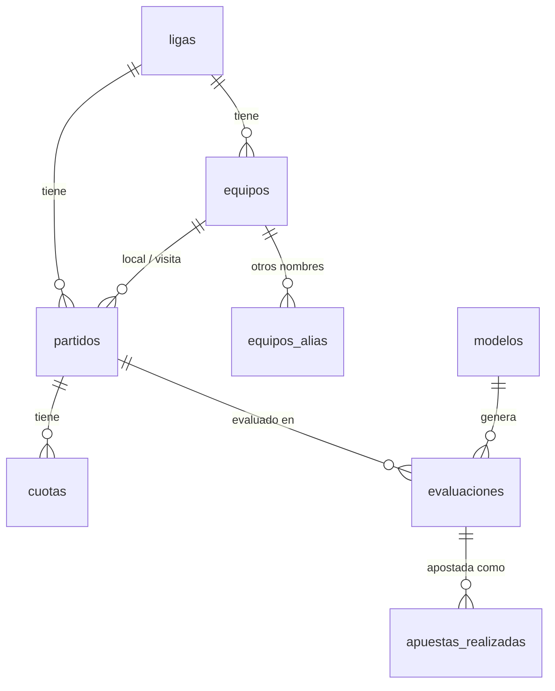

# Modelo de datos (Supabase)

Proyecto: **`BDapuestas`** (Supabase, us-west-2), esquema `public`. Tablas creadas el 2026-11-22.

Scripts: `apuestas-sistema/supabase/migrations/0001_esquema_inicial.sql` y `0002_bandeja_mensajes.sql` (se aplican con `apuestas migrar`).

Las tablas viven en el esquema de `DB_SCHEMA` (`public` si el proyecto es solo para esto;
`apuestas` si se comparte un proyecto). La tabla `migraciones_aplicadas` registra qué migraciones
ya se aplicaron. En el SQL Editor de un proyecto compartido, empieza con `set search_path to apuestas;`.



## Tablas

| Tabla | Qué guarda | Quién escribe |
|---|---|---|
| `ligas` | Ligas configuradas (código, ID en OddsPapi, activa) | Sistema (desde `ligas.yaml`) |
| `equipos` | Nombre "oficial" de cada equipo = el de football-data | Sistema |
| `equipos_alias` | Cómo llama OddsPapi a cada equipo | Sistema (auto si similitud ≥ 0.80) o tú |
| `alias_pendientes` | Nombres que no se pudieron emparejar solos | Sistema → **revisar a mano** |
| `partidos` | Partidos pasados (con resultado) y próximos | Sistema |
| `cuotas` | 3 cuotas (local/empate/visita) de una casa en un momento | Sistema |
| `modelos` | Parámetros de cada modelo entrenado (JSON) | Sistema (lunes) |
| `evaluaciones` | Cada vez que el embudo evalúa un partido: pick o descarte + motivo | Sistema |
| `apuestas_realizadas` | Lo que apostaste de verdad | Tú (comando o endpoint) |
| `ejecuciones` | Registro de cada corrida (ok / error) | Sistema |
| `uso_api` | Cada consulta a OddsPapi (para no pasar el límite) | Sistema |
| `mensajes_salida` | Bandeja: cada mensaje por entregar (alerta, resumen, prueba), su estado e intentos | API escribe; mensajero del VPS marca |
| `migraciones_aplicadas` | Qué migraciones ya se aplicaron | `apuestas migrar` |

### `cuotas.casa` y `cuotas.tipo`

| casa | tipo | Origen |
|---|---|---|
| `apuestatotal` | `apertura` (primera vez vista), `snapshot` (siguientes) | OddsPapi |
| `pinnacle` | `apertura`, `snapshot` | OddsPapi |
| `betfair-ex` | `apertura`, `snapshot` | OddsPapi (desde v1.4.0) |
| `pinnacle` | `previa`, `cierre` | football-data |
| `b365` | `previa` | football-data |
| `promedio` | `cierre` | football-data |

### `evaluaciones.motivo`

| Motivo | Paso | Significado | Desde |
|---|---|---|---|
| `pocos_datos` | 1 | Pocos partidos de algún equipo (solo con `fuente_probabilidad: modelo`) | v1.0 |
| `sin_prediccion` | 2 | El modelo no conoce a un equipo (solo modo modelo) | v1.0 |
| `sin_referencia` | 2 | No hay cuotas de Pinnacle | v1.3 |
| `sin_cuotas` | 3 | No hay cuotas válidas de Apuesta Total | v1.0 |
| `sin_valor` | 3 | La ventaja no llega al mínimo | v1.0 |
| `cuota_fuera_rango` | 4 | Cuota fuera de 1,50–4,00 | v1.0 |
| `ventaja_sospechosa` | 4 | Apuesta Total y el precio justo difieren > 10 puntos | v1.0 |
| `referencia_vieja` | 4 | La cuota de Pinnacle no cambia hace > 12 h | v1.4 |
| `sin_consenso` | 4 | Pinnacle y Betfair no coinciden en que hay ventaja | v1.4 |
| `mercado_en_contra` | 4 | Pinnacle se movió en contra > 3 puntos | v1.0 |

Vacío si es pick.

### Columnas de `evaluaciones` (v1.4.0)

- `p_local`, `p_empate`, `p_visita`: la probabilidad que **decidió** (precio justo de Pinnacle + Betfair en
  modo mercado; nuestro modelo en modo modelo). Hasta v1.3.0 guardaban siempre nuestro modelo.
- `p_mercado`: en modo mercado, la probabilidad que implica la cuota de Apuesta Total (sin su margen).
- `ev`: la mejor ventaja del partido, aunque no llegue al mínimo.

### `evaluaciones.detalles` (JSON)

Claves que guarda el embudo (v1.4.0): `fuente_probabilidad`, `p_justa`, `p_nuestro_modelo`, `ev_minimo`,
`candidatos` (selección, cuota, probabilidad y EV de cada una), `p_mercado_blanda` (Apuesta Total sin margen),
`p_mercado_referencia` (Pinnacle sin margen), `referencias_usadas`, `ev_por_referencia`,
`antiguedad_referencia_horas`, `antiguedad_blanda_horas`, `movimiento_referencia` y `modelo`
(componentes: dixon_coles, elo y, si están activos, pi y pi_tiros; método de mezcla; goles esperados).

## Vistas

- `v_rendimiento_alertas`: cada alerta enviada con su resultado, ganancia en unidades y **CLV**
  (qué tan buena fue la cuota frente al cierre de Pinnacle).
- `v_resumen_apuestas`: apuestas reales por mes (apostado, ganado, perdido).

## Consultas útiles (SQL Editor de Supabase)

```sql
-- Nombres por revisar
select * from alias_pendientes where not resuelto;

-- Resolver uno a mano (ejemplo: "Club X" de OddsPapi es el equipo 42)
insert into equipos_alias (equipo_id, fuente, nombre_fuente, confirmado) values (42, 'oddspapi', 'Club X', true);
update alias_pendientes set resuelto = true where nombre_fuente = 'Club X';

-- ¿Cuántas veces Apuesta Total pagó más que el precio justo? (aunque no llegara al mínimo)
-- La columna ev guarda la mejor ventaja de cada evaluación (local, empate o visita)
select count(*) filter (where ev > 0)    as pago_mas_que_justo,
       count(*) filter (where ev >= 0.02) as llego_al_minimo,
       count(*)                           as evaluados,
       round(max(ev) * 100, 1)            as mejor_ventaja_pct
from evaluaciones where evaluado_en > now() - interval '7 days';

-- Por qué se descartaron los partidos de la última semana
select motivo, count(*) from evaluaciones where evaluado_en > now() - interval '7 days' group by 1 order by 2 desc;

-- Rendimiento de las alertas
select count(*) alertas, avg(clv) clv_medio, sum(ganancia_unidades) ganancia from v_rendimiento_alertas;

-- Consultas a OddsPapi este mes
select count(*) from uso_api where momento >= date_trunc('month', now());

-- Espacio usado
select pg_size_pretty(pg_database_size(current_database()));
```

## Fuentes

| Fuente | Qué da | Límite | Notas |
|---|---|---|---|
| football-data.co.uk | Resultados, tiros (`HS/AS/HST/AST`), cuotas previas y de cierre (CSV) | Sin límite práctico | Se actualiza ~2 veces por semana. **No incluye Perú.** Pinnacle previa dejó de venir a mitad de 2025/26 |
| OddsPapi | Cuotas actuales de ~300 casas: usamos `apuestatotal`, `pinnacle` y `betfair-ex` | 250 consultas/mes gratis | 1 consulta = 1 casa × hasta 5 ligas (la lista de casas dio 400). Cada precio trae `changedAt` |
