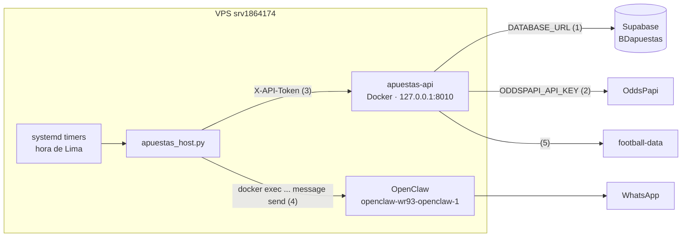

# Conexiones: qué necesita cada servicio

Estado al 2026-11-22. Por servicio: qué dato hace falta, dónde va y cómo comprobarlo.

## Resumen

| # | Conexión | Estado | Dato que falta | Dónde va | Cómo compruebo |
|---|---|---|---|---|---|
| 1 | API → Supabase | ✅ Verificado desde el VPS | Cadena "Session pooler" con tu contraseña | `.env` → `DATABASE_URL` | `apuestas verificar` |
| 2 | API → OddsPapi | ✅ Verificado desde el VPS | API key | `.env` → `ODDSPAPI_API_KEY` | `apuestas verificar --con-oddspapi` (gasta 1) |
| 3 | Programador/mensajero → API | ✅ Instalado (`instalar.sh`) | Token (se genera solo) | `.env` y `/etc/apuestas/host.env` | `python3 vps/apuestas_host.py estado` |
| 4 | Mensajero → OpenClaw → WhatsApp | ✅ `probar-whatsapp` OK desde el host | Tu número | `/etc/apuestas/host.env` (lo pide `instalar.sh`) | `python3 vps/apuestas_host.py probar-whatsapp` |
| 5 | API → football-data | ✅ Verificado desde el VPS | — | — | `apuestas verificar` |
| — | n8n | **No hace falta** | — | — | Ver [n8n opcional](#n8n-opcional) |



---

## 1. Supabase (`BDapuestas`)

**Hecho:** las 13 tablas están creadas en el esquema `public` del proyecto `BDapuestas`, con RLS
activado en todas (sin políticas: nadie puede leerlas desde la API pública de Supabase; el sistema
entra como `postgres`). El asesor de seguridad solo muestra el aviso informativo "RLS sin políticas",
que es lo esperado.

**Falta (solo tú puedes hacerlo, porque lleva tu contraseña):**
1. Supabase → `BDapuestas` → botón **Connect** → **Session pooler**.
2. Copia la cadena y cambia `[YOUR-PASSWORD]` por la contraseña de la base de datos
   (¿no la recuerdas? *Project Settings → Database → Reset database password*).
3. En tu PC, dentro de `apuestas-sistema`:
   ```bash
   apuestas configurar     # pega la cadena; DB_SCHEMA = public
   apuestas migrar         # debe decir "No habia migraciones pendientes"
   apuestas verificar
   ```

El proyecto está en la región **us-west-2**. Funciona igual; solo agrega algo de latencia (unos
segundos más por escaneo), sin impacto en el uso.

### Errores típicos
| Mensaje | Arreglo |
|---|---|
| `password authentication failed` | Contraseña incorrecta: resetearla en Supabase. |
| `Tenant or user not found` | En el pooler el usuario es `postgres.luxfvuxhnxcqijsgmuee`; copia la cadena completa. |
| `Network is unreachable` / host `db.xxx.supabase.co` | Es la conexión directa (IPv6). Usa **Session pooler**. |
| Puerto `6543` | Es el *Transaction pooler*: cambia a 5432. |

---

## 2. OddsPapi

1. Crear cuenta en oddspapi.io y copiar la **API key**.
2. `apuestas configurar` (paso 3).
3. `apuestas verificar --con-oddspapi`: gasta **1 consulta** y comprueba la key y que cada ID de liga
   corresponda al torneo correcto.
4. `apuestas probar-oddspapi --torneo 17`: revisa la lista de `05-operacion/runbook.md` →
   "Primera conexión con OddsPapi".

---

## 3 y 4. Programador, mensajero y WhatsApp

Tu VPS ya tiene OpenClaw en Docker (`openclaw-wr93-openclaw-1`) y lo administras con
`docker exec ... openclaw ...`. El mensajero usa ese mismo camino:

```bash
docker exec openclaw-wr93-openclaw-1 openclaw message send --channel whatsapp --target +51XXXXXXXXX --message "texto"
```

- El texto llega **exacto**: no pasa por Gemini. Eso importa porque los registros del VPS muestran
  fallos frecuentes de Gemini (503, 429 y 404); el envío directo no depende del modelo.
- Si WhatsApp está reconectando (pasa cada ~2 h con el watchdog), el mensaje queda en la bandeja y
  se reintenta a los 5 minutos, hasta 5 veces. Las alertas caducan al empezar el partido.

**Primera prueba (por SSH en el VPS, como root):** antes de instalar nada, confirma que el
comando existe y entrega:
```bash
docker exec openclaw-wr93-openclaw-1 openclaw message send --channel whatsapp --target +51TU_NUMERO --message "prueba"
```
Si te llega, todo el camino de envío funciona. Si da error, mándame el mensaje.

Instalación completa: [instalacion-paso-a-paso.md → D](instalacion-paso-a-paso.md#d-vps).

---

## 5. football-data.co.uk

No necesita cuenta. `apuestas verificar` descarga el archivo de la temporada actual para comprobar
que hay salida a internet.

---

## n8n (opcional)

No está instalado y **no hace falta**: los horarios los ponen los timers de systemd y el envío lo hace
el mensajero. Instalar n8n solo para esto sumaría un servicio más (memoria, actualizaciones y una
interfaz web que proteger) en un VPS de 1 vCPU sin firewall activo.

Si más adelante lo quieres para otras automatizaciones, los flujos de `apuestas-sistema/n8n/` ya
llaman a las mismas tareas (`POST /tareas/...`). Ver [ADR 0010](../02-decisiones/0010-programador-systemd-y-mensajero.md).
