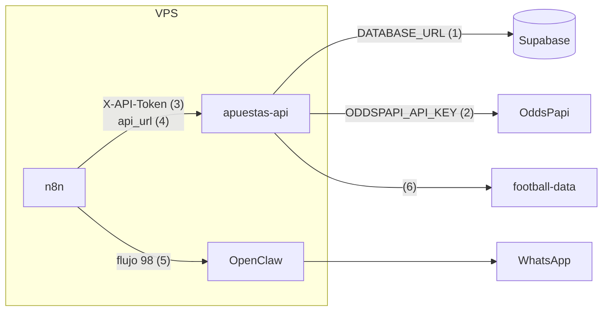

# Conexiones: qué necesita cada servicio

El sistema queda listo para conectarse. Esta hoja dice, por servicio, **qué dato hace falta,
dónde va y cómo comprobar que funciona**.

## Resumen

| # | Servicio | Dato que necesitas | Dónde va | Cómo compruebo |
|---|---|---|---|---|
| 1 | Supabase | Cadena "Session pooler" | `.env` → `DATABASE_URL` (+ `DB_SCHEMA`) | `apuestas verificar` |
| 2 | OddsPapi | API key | `.env` → `ODDSPAPI_API_KEY` | `apuestas verificar --con-oddspapi` (gasta 1) |
| 3 | API del sistema | Token (se genera solo) | `.env` → `API_TOKEN` y credencial `Apuestas API` en n8n | Flujo 00 de n8n |
| 4 | n8n → API | URL de la API | Nodo **Config** de cada flujo | Flujo 00 de n8n |
| 5 | n8n → WhatsApp | Modo de envío + tu número | Nodo **Config envio** del flujo 98 | Flujo 00 de n8n (te llega un mensaje) |
| 6 | football-data | Nada (es público) | — | `apuestas verificar` |

Atajo para los 3 primeros: **`apuestas configurar`** pide cada dato, prueba la base de datos al
momento y genera el token.



---

## 1. Supabase

### Decisión pendiente: ¿qué proyecto usar?

Tu organización de Supabase está en el **plan gratis** y ya tiene **2 proyectos activos**
(`saas-dev` y `movil-negocios`). El plan gratis permite 2 proyectos activos, así que para crear
uno nuevo hay que elegir:

| Opción | Qué haces | `DB_SCHEMA` | A favor | En contra |
|---|---|---|---|---|
| **A. Proyecto nuevo** | Pausar uno de los dos y crear `apuestas` | `public` | Todo separado, 500 MB propios | Un proyecto queda pausado |
| **B. Proyecto existente** | Usar uno de los dos que ya tienes | `apuestas` | Sin pausar nada, listo hoy | Comparte los 500 MB y el panel con ese sistema |
| C. Plan Pro | Pagar el plan Pro | `public` | Sin límites prácticos | Costo mensual |

El sistema funciona igual en las tres. Con la opción B todas sus tablas quedan en el esquema
`apuestas` y no tocan las de `public`.

### Pasos
1. Supabase → el proyecto elegido → botón **Connect** → **Session pooler** (puerto 5432).
2. Copia la cadena y cambia `[YOUR-PASSWORD]` por la contraseña de la base de datos.
   ¿No la recuerdas? *Project Settings → Database → Reset database password*.
3. En tu PC, dentro de `apuestas-sistema`:
   ```bash
   apuestas configurar     # pega la cadena; DB_SCHEMA = public (A/C) o apuestas (B)
   apuestas migrar         # crea las 11 tablas (+ registro de migraciones)
   apuestas verificar
   ```

### Errores típicos
| Mensaje | Arreglo |
|---|---|
| `password authentication failed` | Contraseña incorrecta: resetearla en Supabase. |
| `Tenant or user not found` | En el pooler el usuario es `postgres.<ref>`; copia la cadena completa. |
| `Network is unreachable` / host `db.xxx.supabase.co` | Es la conexión directa (IPv6). Usa **Session pooler**. |
| Puerto `6543` | Es el *Transaction pooler*: cambia a 5432. |
| Timeout | Proyecto pausado: ábrelo en el panel para reactivarlo. |

---

## 2. OddsPapi

1. Crear cuenta en oddspapi.io y copiar la **API key**.
2. `apuestas configurar` (paso 3) o pegarla en `.env` → `ODDSPAPI_API_KEY`.
3. `apuestas verificar --con-oddspapi` → gasta **1 consulta** y comprueba la key **y** que los IDs
   de las ligas activas existan (muestra el nombre de cada torneo para que confirmes que es el correcto).
4. `apuestas probar-oddspapi --torneo 17` → 1 consulta más; revisa la lista de chequeo de
   `05-operacion/runbook.md` → "Primera conexión con OddsPapi".

---

## 3 y 4. n8n → API

- La API corre en Docker en el VPS y solo escucha en `127.0.0.1:8010`.
- **¿Cómo está instalado tu n8n?** (pregunta abierta):
  - Directo en el VPS (npm/pm2): `api_url = http://127.0.0.1:8010`.
  - En Docker: unir los contenedores a la misma red (ver `docker-compose.yml`) y usar
    `api_url = http://apuestas-api:8000`.
- Credencial **Header Auth** `Apuestas API`: Name `X-API-Token`, Value = `API_TOKEN` del `.env`.

---

## 5. n8n → WhatsApp (OpenClaw)

Todo sale por el flujo **98 - Enviar mensaje**. Se configura una vez en su nodo **Config envio**.

| Modo | Cómo entrega | Requisito | Exactitud del texto |
|---|---|---|---|
| `comando` (recomendado) | `openclaw message send --channel whatsapp --target +51...` | n8n instalado directo en el VPS, mismo usuario que OpenClaw; nodo *Execute Command* habilitado | Exacta: no pasa por Gemini |
| `webhook_openclaw` | POST a `/hooks/agent` del Gateway con `channel: whatsapp` y `to: +51...` | `hooks.enabled: true` y `hooks.token` en la config de OpenClaw; credencial `OpenClaw Hooks` en n8n | Pasa por el agente: se le pide no cambiar nada, pero hay que vigilarlo |
| `webhook` | POST `{"mensaje": ...}` a una URL | Otro puente | Depende del puente |

Prueba manual del modo `comando`, por SSH en el VPS:
```bash
openclaw message send --channel whatsapp --target +51XXXXXXXXX --message "Prueba del sistema de apuestas"
```

Para el modo `webhook_openclaw`, en la config de OpenClaw:
```json5
hooks: {
  enabled: true,
  token: "<token-largo-y-aleatorio>",
  path: "/hooks",
  allowedAgentIds: ["main"],
}
```

---

## 6. football-data.co.uk

No necesita cuenta. `apuestas verificar` descarga el archivo de la temporada actual de la primera
liga activa para comprobar que hay salida a internet.

---

## Prueba final del circuito

En n8n: **Apuestas 00 - Prueba de conexiones → Execute workflow**.
Hace n8n → API (`/salud`) → API → Supabase (`/diagnostico`) → flujo 98 → WhatsApp.
Si te llega el mensaje "PRUEBA DE CONEXIONES" con todo en OK, ya se pueden activar los flujos.
